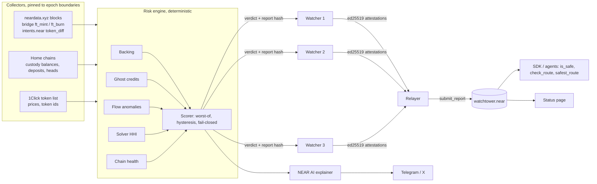

# Intents Watchtower

A bridge can credit tokens on NEAR that nothing on the home chain backs, and nobody notices until withdrawals fail. Intents Watchtower checks every bridge each minute and tells apps and AI agents whether a route is safe before they use it.

Intents Watchtower is an open, verifiable safety layer for NEAR Intents. It reconciles what is held on every home chain against what is credited on NEAR, catches credits that have nothing behind them, and publishes a signed verdict per route to an on-chain oracle. Any wallet, app or AI agent can ask, for free, whether a route is safe and how much it can carry before moving money:

```ts
await wt.isSafe("btc:bitcoin->usdc:near")              // false when backing, flows, solvers or a dependency look wrong
await wt.checkIntent("btc:bitcoin->usdc:near", 50_000)  // allowed only if safe AND $50K fits the signed safe size
```

The status page, the plain-language explanations and the AI-agent explanations are available in English, 简体中文, 日本語, 한국어, Español, Français, Português, Deutsch, Русский, Türkçe and Tiếng Việt (Settings → Language).

Every verdict also carries a signed **safe size** (the most a route can carry right now), the contract enforces it with `check_intent(route, amount)`, people get a **"Check a swap"** answer (go, send it in parts, use another route, don't send now), and AI agents get the same answer through an **MCP server** before they move money. Why each piece exists, with sources: [docs/STRATEGY.md](docs/STRATEGY.md).

---

## Try it in five minutes

Each row is one action and what you should see. The first needs nothing installed; the rest need Node 20 or newer.

| Do | See |
|---|---|
| Open https://www.intentswatchtower.xyz | The live status page: 12 routes with verdicts read from the NEAR contract, "Watchers agreeing 3 of 3", and the backing of each bridged asset read from its home chain by your browser |
| Run the `curl` command under [Live right now](#live-right-now) | JSON from the contract on NEAR: every route with its status, reasons, safe size and report hash |
| `npm install --legacy-peer-deps` then `npm test` | `208 passed` |
| `npm run demo` | The 1 October replay. Look for `T+4m ● RED 3 routes` and `$3.63M (97.6%) moved after Watchtower was red` |
| `npm run cli -- agent-demo` | An agent asked to move $25,000 is refused the red route and `rerouted to usdc:ethereum->sol:solana` |
| `npm run app`, then open `apps/status/dist/site/index.html` | The same status page offline, in replay mode: press play and watch the route turn red |
| `npm run test:contract` (needs Rust) | 35 contract tests pass, including Rust verifying signatures made in TypeScript |

## How NEAR fits in

- **The verdicts live in a NEAR smart contract** (`contracts/watchtower`, Rust, near-sdk). It verifies each watcher's ed25519 signature, requires a quorum, turns red fast and green slowly, and stores one verdict per route.
- **Anyone can read it for free.** `is_safe(route)` and `check_intent(route, amount)` are view calls, so a wallet, a contract or an AI agent can ask before it sends.
- **What it watches is NEAR Intents.** The watchers read the supply of bridged tokens on NEAR mainnet and compare it with the bridge treasuries on Bitcoin, Ethereum, Solana, BNB Chain and Litecoin.
- **Testnet and mainnet.** The verdict contract is on NEAR testnet (`watchtower.intentswatch-ade.testnet`). All the data it judges is read from mainnet.

## Disclosures

- **When it was built:** all of the code was written during the hackathon window (19 October to 14 November 2026). There is no earlier baseline.
- **AI assistance:** built by a solo developer with help from an AI coding assistant (Claude). I designed it, ran it and checked every result.
- **Libraries:** near-sdk (contract); near-api-js, @noble/ed25519, @noble/hashes, preact, @electric-sql/pglite (apps and packages); esbuild, tsx, TypeScript, vitest, jsdom (build and tests); ed25519-dalek, serde_json, hex (contract tests).
- **Simulations:** the incident replays are simulations modelled on public reports, not recordings of the real events. The live page and the figures under "Live right now" are real.

---

## What is in this repo

| Part | Path | State |
|---|---|---|
| Deterministic risk engine: 5 checks, scorer, hysteresis, fail-closed | `packages/engine` | Built, 23 unit tests |
| Safe size and swap pre-flight: signed capacity per route, go / reduce / reroute / wait | `packages/engine/src/capacity.ts` | Built, 16 tests incl. the October replay |
| `watchtower.near` contract: signed reports, quorum, fast-red/slow-green, `check_intent`, receipts, guardian | `contracts/watchtower` | Built, 35 Rust tests |
| MCP server for AI agents: `check_swap`, `check_route`, `list_routes`, `explain_route` | `packages/mcp` | Built, 13 tests incl. a real stdio session |
| Cross-language test vectors: TypeScript signs, Rust verifies | `test-vectors/` | Built, checked in both suites |
| Watcher node, relayer/aggregator, local N-watcher network | `packages/watcher` | Built, tested on the October replay |
| Exploit time machine: deterministic world + 5 scenarios | `packages/replay` | Built, 30 tests |
| Agent SDK: `isSafe`, `check`, `safestRoute`, `withWatchtower`, `<watchtower-badge>` | `packages/sdk` | Built, tested (RPC + contract model) |
| AI explainer: NEAR AI with hallucination guard, templates in eleven languages | `packages/explainer` | Built, tested |
| Live collectors: neardata.xyz indexer, NEAR RPC, 1Click tokens, PoA bridge, Esplora, EVM, Solana | `packages/collectors` | Built, parser tests on fixtures; running against mainnet data since November 2026 |
| Custody finder: traces deposits, sweeps, payouts and refills to find a bridge's treasury, then checks it against the official list | `packages/watcher/src/custody.ts` | Built, tested; used to produce the live results below |
| Postgres schema + store (PGlite in dev, any `pg` pool in prod) | `db/`, `packages/store` | Built, tested on real SQL via PGlite |
| Telegram alerts and X post formatter | `apps/bot` | Built, tested |
| Status app (Preact): verdict, "Check a swap" planner, route table with safe size, incident replay, chain contagion, watcher quorum, agent demo, live-contract mode, light/dark | `apps/status` | Built, end-to-end UI test, screenshot-reviewed on phone and desktop in light and dark |
| TypeScript model of the contract (same rules, used by the page and tests) | `packages/core/src/mirror.ts` | Built, checked against the same vectors |

**243 automated tests** (208 TypeScript + 35 Rust) run with `npm run ci`.

---

## Live right now

Three watchers read **real mainnet data** (the NEAR Intents token supply on NEAR, and the bridge treasuries on Bitcoin, Ethereum, Solana, BNB Chain and Litecoin) and sign verdicts into a contract on NEAR testnet: `watchtower.intentswatch-ade.testnet`. Only the verdict contract is on testnet; every number it judges is mainnet's.

What it found, checked against the [official treasury list](https://docs.near-intents.org/security-compliance/treasury-addresses):

| Asset | Backing | Verdict |
|---|---|---|
| ETH and USDC on Ethereum, SOL on Solana, USDT and BNB on BNB Chain | 100% or more | Fully backed |
| BTC on Bitcoin | 97.47% (about 2.21 BTC short, steady since at least May 2026) | Partly verified |
| LTC on Litecoin | about 98.6% (about 163 LTC short) | Partly verified |

Figures as measured on 9 November 2026; the status page reads them fresh from the chains. For Bitcoin and Litecoin, Watchtower ruled out three causes with public data (tokens the bridge holds itself, unswept deposits and unpaid withdrawals, miner fees). It does not know the reason for the rest, so it says "partly verified" instead of guessing, and turns red if the gap grows. How: [docs/METHODOLOGY.md](docs/METHODOLOGY.md).

Read the contract yourself, with no setup:

```bash
curl -s https://test.rpc.fastnear.com -H 'content-type: application/json' -d '{"jsonrpc":"2.0","id":1,"method":"query","params":{"request_type":"call_function","finality":"final","account_id":"watchtower.intentswatch-ade.testnet","method_name":"list_routes","args_base64":"e30="}}'
```

**Live status page: https://www.intentswatchtower.xyz**

It builds from this repo on Vercel (`vercel.json`): it opens on that contract and re-checks every treasury itself in your browser, from the public wallet list in `config/public.config.json`.

---

## Quick start

```bash
npm install --legacy-peer-deps
npm test                         # 208 TypeScript tests
npm run test:contract            # 35 Rust contract tests (needs Rust)

npm run replay -- all            # every scenario through the real engine
npm run replay -- oct-2026-ghost-credit --lang fr
npm run cli -- simulate --scenario apr-2026-litecoin-zero-day
npm run cli -- agent-demo        # an agent reroutes around a red route
npm run build:status             # apps/status/dist/site/index.html, deploy anywhere static
npm run build:mcp                # packages/mcp/dist/watchtower-mcp.mjs, the agent server (plain node)
npm run mcp                      # run the agent server from source
```

### On Windows (PowerShell)

```powershell
# after cloning this repository
cd .\intents-watchtower
npm install --legacy-peer-deps
npm test
npm run demo           # October replay in the terminal
npm run app            # builds the status app
Start-Process .\apps\status\dist\site\index.html
# live: $env:WATCHTOWER_LIVE="testnet:watchtower.intentswatch-ade.testnet"; $env:WATCHTOWER_CONFIG="config/public.config.json"; npm run app
# the page then also checks every bridge's backing itself, from the wallets in that config
```

**Connecting an AI agent:** run `npm run build:mcp` once, then `claude mcp add watchtower -- node <path to this repository>/packages/mcp/dist/watchtower-mcp.mjs` (Claude Code). Claude Desktop, Codex and Cursor are in [packages/mcp/README.md](packages/mcp/README.md).

Other demos: `npm run demo:all`, `demo:french`, `demo:whale`, `demo:agent`, `demo:network`. These need no `--`, which PowerShell can swallow. If PowerShell says running scripts is disabled, run `Set-ExecutionPolicy -Scope CurrentUser RemoteSigned` once, or use `npm.cmd` instead of `npm`. The Rust contract tests (`npm run test:contract`) need Rust from https://rustup.rs and the Visual Studio C++ Build Tools; `npm run deploy` installs the Rust version the contract is pinned to (see [docs/MAINNET.md](docs/MAINNET.md)).

## What the replays show

All five scenarios run on a seeded simulation with a real double-entry ledger (custody, credited supply, deposits in flight, pending withdrawals). Incidents are modelled on public reports; they are not recordings of on-chain data. Each one is reproducible bit for bit.

| Scenario | First alert | First red | Red on unrelated routes | Outcome |
|---|---|---|---|---|
| **1 Oct 2026 ghost credits** (~$3.8M in waves through the BSC hot wallet) | T+0 (backing falling fast) | **T+4** (unbacked credit already being withdrawn) | 0 minutes | **97.6% of the simulated drain happened after Watchtower was red** |
| April 2026 Litecoin zero-day (advisory + 4-block reorg) | T+0 | T+0 on both LTC routes | 0 minutes | Only Litecoin routes move; they recover with hysteresis |
| Whale withdraws $1.95M of ETH legitimately | T+0 | never | 0 minutes | One signal = amber only; back to green in 70 min |
| Bitcoin custody feed goes silent for 25 min | T+10 (unknown) | never | 0 minutes | `is_safe` false while blind; recovers at T+30 |
| USDT on BSC depegs to $0.962 | T+0 | T+0 | 0 minutes | Back to green 5 minutes after the peg returns |

These numbers come from `npm run replay -- all` and are asserted in `packages/replay/test`. They show how the engine behaves on this pattern. **They are not a claim about when the real October exploit would have been caught**, because its exact on-chain timing is not public. Point the same engine at real historical blocks with the neardata collector to get that number.

---

## How it works



### The five checks

| Check | Question | Red when |
|---|---|---|
| 1. Proof of backing | Is every credited token backed on its home chain? | `custody ÷ (credited + pending withdrawals + deposits in flight)` < 99.5%, or below 100% and falling fast |
| 2. Ghost credits | Does every NEAR credit pair with a real deposit? | unpaired past the chain's observer window, or unpaired and already being withdrawn |
| 3. Flow anomalies | Does money move like an attack? | two of: outflow z-score ≥ 4, hot wallet −30% in 15 min, new accounts exiting ≥ $50K, mint-then-exit |
| 4. Solver concentration | Is liquidity real and competitive? | 24h HHI > 2,500 or one solver > 70% |
| 5. Chain health and contagion | Is any dependency in trouble? | stall, deep reorg, red advisory, or stablecoin off peg by 3% |

A route's status is the worst of every check on both assets, the route itself, and every chain it touches (always including NEAR). The full method, with every threshold and the reasons behind it, is in [docs/METHODOLOGY.md](docs/METHODOLOGY.md).

Three deliberate departures from the original spec, each justified in the methodology:

1. **In-flight deposits are liabilities.** A deposit already sitting in custody but not yet credited is owed to its user, so it goes in the denominator. The spec's formula would have overstated backing during busy periods.
2. **Two-signal rule for anomalies.** A single extreme z-score is amber, not red. The whale scenario shows why: one legitimate withdrawal would otherwise switch off a route for an hour.
3. **"Unknown" ranks above amber.** Stale data is never treated as caution-but-OK; `is_safe(..., allow_amber=true)` still returns false.

### The contract

```text
is_safe(route_id, max_age_sec?, allow_amber?) -> bool          free view call
check_route(route_id, ...) -> { safe, verdict, status, score, capacity_usd, reasons, age_sec, report_hash }
check_intent(route_id, amount_usd, ...) -> { allowed, verdict: "ok" | "over_capacity" | ..., capacity_usd, ... }
check_routes([...]), safest_route([...]), get_route_health, list_routes, get_pending_rounds
submit_report(route_id, report, attestations[])                 anyone can relay; authority is in the signatures
submit_reports([{ route_id, report, attestations }])             a whole round in one transaction (what watchers use)
record_receipt(route_id, intent_hash)  (payable)                safety receipt; caller pays its own storage
pause / set_override  (guardian)                                can only ever make routes less safe
add_watcher, remove_watcher, set_quorum, set_timing (owner)     moves to DAO governance later
```

Safety properties, each covered by a test in `contracts/watchtower/src/tests.rs`:

- **Fail-closed.** No data, stale data, unknown status or a paused contract is never safe.
- **Fast red, slow green.** One signature raises the alarm. Recovery, keeping green fresh, and even softening red into unknown all need the quorum. One honest watcher can always pull the alarm; one compromised watcher can never silence it.
- **Unreplayable signatures.** Each signature covers `iwt:v2|contract|route|epoch|status|score|capacity_usd|reasons|report_hash`, so a relayer can't inflate the safe size.
- **No size on unsafe routes.** Red and unknown verdicts must carry `capacity_usd = 0`; the contract rejects anything else.
- **Monotonic epochs.** Reports from the future, older than 15 minutes, or older than the stored epoch are rejected.
- **Watchers agree on the verdict, not on every byte.** The contract keeps each watcher's latest signed verdict per route. Red or amber needs one fresh vote (the alarm stays while its raiser asserts it), green needs two that agree with no alarm standing, and the stored safe size is the smallest of them. Watchers reading live chains seconds apart never hash identical inputs, so matching on hashes alone would never reach green.
- **Disagreement is public.** Fresh votes with different statuses emit a `watcher_disagreement` event, and every watcher's latest vote is readable with `get_pending_rounds`.
- **Verifiable.** Only the report hash goes on-chain. Anyone with the published report can recompute it (`verifyVerdict`).

### For agents

```ts
import { Watchtower, withWatchtower } from "@intents-watchtower/sdk";

const wt = new Watchtower({ network: "mainnet" });
const safeAgent = withWatchtower(agent, {
  client: wt,
  alternatives: (route) => routesInto(route),            // optional
  withRoute: (args, route) => [{ ...args[0], route }],   // how to retarget a call
});
await safeAgent.swap({ route: "usdt:bsc->usdc:near", amount }); // rerouted or RouteUnsafeError
```

The SDK has no dependencies, fails closed when the oracle is unreachable, and caches identical calls for 5 seconds. For wallets: `<watchtower-badge route="eth:ethereum->usdc:near"></watchtower-badge>`.

**AI agents without code** connect to the MCP server and call `check_swap` before sending:

```
REROUTE. Don't send via USDT on BNB Chain → USDC on NEAR now: Only 92.53% of credited funds are backed,
and $1.93M were credited on NEAR with no matching deposit. Avoid this route until it turns green.
If you can fund from ETH on Ethereum instead, use that: ETH on Ethereum → USDC on NEAR is healthy
(score 100/100) and can take up to $120,000.
```

"go" is only returned when the contract's own `check_intent` also allows it. Setup for Claude Code, Claude Desktop, Codex and Cursor: [packages/mcp/README.md](packages/mcp/README.md).

---

## Going live

The safe order is testnet first, with watchers reading **real mainnet data** and publishing to the testnet contract, then mainnet after a week of verdicts that match reality. The full walkthrough, with PowerShell commands, is [docs/MAINNET.md](docs/MAINNET.md).

```powershell
npm run doctor        # read-only check of NEAR, the indexer, prices, bridge supplies, home chains and custody config
npm run deploy        # guided: asks testnet or mainnet, builds, deploys, registers 3 watchers, quorum 2 of 3
npm run relayer       # once: the account that pays the watchers' gas
npm run watch:dry     # one watcher round against live data, sends nothing
npm run watch:1       # watcher 1 signs and submits every minute (watch:2 and watch:3 in other windows)
npm run custody       # after a few hours: trace recorded bridge transactions to the bridges' wallets
```

Build the status page with `WATCHTOWER_LIVE=testnet:watchtower.you.testnet` set and it opens on your live contract instead of a replay (no play button: it shows the current verdicts and refreshes every 20 seconds).

## Deploying by hand

1. `OWNER=you.testnet ./scripts/deploy-testnet.sh` (macOS/Linux) or `npm run deploy` (any system) builds the wasm, deploys `watchtower.you.testnet`, generates three watcher keys and sets quorum 2 of 3.
2. Copy `config/watchtower.example.json` to `watchtower.config.json` and fill in custody addresses ([how to find them](docs/RUNBOOK.md#finding-custody-addresses)).
3. Run each watcher on a separate machine with its own key and RPC providers: `npm run watch -- --config watchtower.config.json --submit`, or `docker compose up` for all three on one host.
4. Point the SDK o are in [packages/mcp/README.md](packages/mcp/README.md).

Other demos: `npm run demo:all`, `demo:french`, `demo:whale`, `demo:agent`, `demo:network`. These need no `--`, which PowerShell can swallow. If PowerShell says running scripts is disabled, run `Set-ExecutionPolicy -Scope CurrentUser RemoteSigned` once, or use `npm.cmd` instead of `npm`. The Rust contract tests (`npm run test:contract`) need Rust from https://rustup.rs and the Visual Studio C++ Build Tools; `npm run deploy` installs the Rust version the contract is pinned to (see [docs/MAINNET.md](docs/MAINNET.md)).

## What the replays show

All five scenarios run on a seeded simulation with a real double-entry ledger (custody, credited supply, deposits in flight, pending withdrawals). Incidents are modelled on public reports; they are not recordings of on-chain data. Each one is reproducible bit for bit.

| Scenario | First alert | First red | Red on unrelated routes | Outcome |
|---|---|---|---|---|
| **1 Oct 2026 ghost credits** (~$3.8M in waves through the BSC hot wallet) | T+0 (backing falling fast) | **T+4** (unbacked credit already being withdrawn) | 0 minutes | **97.6% of the simulated drain happened after Watchtower was red** |
| April 2026 Litecoin zero-day (advisory + 4-block reorg) | T+0 | T+0 on both LTC routes | 0 minutes | Only Litecoin routes move; they recover with hysteresis |
| Whale withdraws $1.95M of ETH legitimately | T+0 | never | 0 minutes | One signal = amber only; back to green in 70 min |
| Bitcoin custody feed goes silent for 25 min | T+10 (unknown) | never | 0 minutes | `is_safe` false while blind; recovers at T+30 |
| USDT on BSC depegs to $0.962 | T+0 | T+0 | 0 minutes | Back to green 5 minutes after the peg returns |

These numbers come from `npm run replay -- all` and are asserted in `packages/replay/test`. They show how the engine behaves on this pattern. **They are not a claim about when the real October exploit would have been caught**, because its exact on-chain timing is not public. Point the same engine at real historical blocks with the neardata collector to get that number.

---

## How it works


### The five checks

| Check | Question | Red when |
|---|---|---|
| 1. Proof of backing | Is every credited token backed on its home chain? | `custody ÷ (credited + pending withdrawals + deposits in flight)` < 99.5%, or below 100% and falling fast |
| 2. Ghost credits | Does every NEAR credit pair with a real deposit? | unpaired past the chain's observer window, or unpaired and already being withdrawn |
| 3. Flow anomalies | Does money move like an attack? | two of: outflow z-score ≥ 4, hot wallet −30% in 15 min, new accounts exiting ≥ $50K, mint-then-exit |
| 4. Solver concentration | Is liquidity real and competitive? | 24h HHI > 2,500 or one solver > 70% |
| 5. Chain health and contagion | Is any dependency in trouble? | stall, deep reorg, red advisory, or stablecoin off peg by 3% |

A route's status is the worst of every check on both assets, the route itself, and every chain it touches (always including NEAR). The full method, with every threshold and the reasons behind it, is in [docs/METHODOLOGY.md](docs/METHODOLOGY.md).

Three deliberate departures from the original spec, each justified in the methodology:

1. **In-flight deposits are liabilities.** A deposit already sitting in custody but not yet credited is owed to its user, so it goes in the denominator. The spec's formula would have overstated backing during busy periods.
2. **Two-signal rule for anomalies.** A single extreme z-score is amber, not red. The whale scenario shows why: one legitimate withdrawal would otherwise switch off a route for an hour.
3. **"Unknown" ranks above amber.** Stale data is never treated as caution-but-OK; `is_safe(..., allow_amber=true)` still returns false.

### The contract

```text
is_safe(route_id, max_age_sec?, allow_amber?) -> bool          free view call
check_route(route_id, ...) -> { safe, verdict, status, score, capacity_usd, reasons, age_sec, report_hash }
check_intent(route_id, amount_usd, ...) -> { allowed, verdict: "ok" | "over_capacity" | ..., capacity_usd, ... }
check_routes([...]), safest_route([...]), get_route_health, list_routes, get_pending_rounds
submit_report(route_id, report, attestations[])                 anyone can relay; authority is in the signatures
submit_reports([{ route_id, report, attestations }])             a whole round in one transaction (what watchers use)
record_receipt(route_id, intent_hash)  (payable)                safety receipt; caller pays its own storage
pause / set_override  (guardian)                                can only ever make routes less safe
add_watcher, remove_watcher, set_quorum, set_timing (owner)     moves to DAO governance later
```

Safety properties, each covered by a test in `contracts/watchtower/src/tests.rs`:

- **Fail-closed.** No data, stale data, unknown status or a paused contract is never safe.
- **Fast red, slow green.** One signature raises the alarm. Recovery, keeping green fresh, and even softening red into unknown all need the quorum. One honest watcher can always pull the alarm; one compromised watcher can never silence it.
- **Unreplayable signatures.** Each signature covers `iwt:v2|contract|route|epoch|status|score|capacity_usd|reasons|report_hash`, so a relayer can't inflate the safe size.
- **No size on unsafe routes.** Red and unknown verdicts must carry `capacity_usd = 0`; the contract rejects anything else.
- **Monotonic epochs.** Reports from the future, older than 15 minutes, or older than the stored epoch are rejected.
- **Watchers agree on the verdict, not on every byte.** The contract keeps each watcher's latest signed verdict per route. Red or amber needs one fresh vote (the alarm stays while its raiser asserts it), green needs two that agree with no alarm standing, and the stored safe size is the smallest of them. Watchers reading live chains seconds apart never hash identical inputs, so matching on hashes alone would never reach green.
- **Disagreement is public.** Fresh votes with different statuses emit a `watcher_disagreement` event, and every watcher's latest vote is readable with `get_pending_rounds`.
- **Verifiable.** Only the report hash goes on-chain. Anyone with the published report can recompute it (`verifyVerdict`).

### For agents

```ts
import { Watchtower, withWatchtower } from "@intents-watchtower/sdk";

const wt = new Watchtower({ network: "mainnet" });
const safeAgent = withWatchtower(agent, {
  client: wt,
  alternatives: (route) => routesInto(route),            // optional
  withRoute: (args, route) => [{ ...args[0], route }],   // how to retarget a call
});
await safeAgent.swap({ route: "usdt:bsc->usdc:near", amount }); // rerouted or RouteUnsafeError
```

The SDK has no dependencies, fails closed when the oracle is unreachable, and caches identical calls for 5 seconds. For wallets: `<watchtower-badge route="eth:ethereum->usdc:near"></watchtower-badge>`.

**AI agents without code** connect to the MCP server and call `check_swap` before sending:

```
REROUTE. Don't send via USDT on BNB Chain → USDC on NEAR now: Only 92.53% of credited funds are backed,
and $1.93M were credited on NEAR with no matching deposit. Avoid this route until it turns green.
If you can fund from ETH on Ethereum instead, use that: ETH on Ethereum → USDC on NEAR is healthy
(score 100/100) and can take up to $120,000.
```

"go" is only returned when the contract's own `check_intent` also allows it. Setup for Claude Code, Claude Desktop, Codex and Cursor: [packages/mcp/README.md](packages/mcp/README.md).

---

## Going live

The safe order is testnet first, with watchers reading **real mainnet data** and publishing to the testnet contract, then mainnet after a week of verdicts that match reality. The full walkthrough, with PowerShell commands, is [docs/MAINNET.md](docs/MAINNET.md).

```powershell
npm run doctor        # read-only check of NEAR, the indexer, prices, bridge supplies, home chains and custody config
npm run deploy        # guided: asks testnet or mainnet, builds, deploys, registers 3 watchers, quorum 2 of 3
npm run relayer       # once: the account that pays the watchers' gas
npm run watch:dry     # one watcher round against live data, sends nothing
npm run watch:1       # watcher 1 signs and submits every minute (watch:2 and watch:3 in other windows)
npm run custody       # after a few hours: trace recorded bridge transactions to the bridges' wallets
```

Build the status page with `WATCHTOWER_LIVE=testnet:watchtower.you.testnet` set and it opens on your live contract instead of a replay (no play button: it shows the current verdicts and refreshes every 20 seconds).

## Deploying by hand

1. `OWNER=you.testnet ./scripts/deploy-testnet.sh` (macOS/Linux) or `npm run deploy` (any system) builds the wasm, deploys `watchtower.you.testnet`, generates three watcher keys and sets quorum 2 of 3.
2. Copy `config/watchtower.example.json` to `watchtower.config.json` and fill in custody addresses ([how to find them](docs/RUNBOOK.md#finding-custody-addresses)).
3. Run each watcher on a separate machine with its own key and RPC providers: `npm run watch -- --config watchtower.config.json --submit`, or `docker compose up` for all three on one host.
4. Point the SDK or the status page at the contract.

Operations, key rotation and incident handling are in [docs/RUNBOOK.md](docs/RUNBOOK.md). Threats and mitigations are in [docs/THREAT_MODEL.md](docs/THREAT_MODEL.md).

## Known gaps, stated plainly

- **Custody addresses** are deployment config. The engine is complete, but a real backing ratio needs the bridges' address sets. Omni Bitcoin uses a fresh address per deposit, which needs an address-discovery pass from bridge events.
- **Live collectors** were written against the documented APIs and tested on fixtures. This build environment cannot reach mainnet RPCs, so the first live run is still to come.
- **The wasm build** runs in CI (`cargo near build`). The contract logic is covered by native unit tests.
- **Solver identity** is inferred from `token_diff` counterparties; settled-swap attribution may need refinement on real traffic.
- **Confidential (TEE) shards** are out of scope for the hackathon; attestation checks are on the roadmap.

## Roadmap

Testnet deployment with three independent watcher operators, then watchers inside TEEs with remote attestation, parametric cover that settles on signed verdicts, per-solver liquidity-exhaustion alerts, an open producer feed for NEAR Intents' SHIELD, and watcher staking and slashing. Details, sources and what is built versus planned: [docs/STRATEGY.md](docs/STRATEGY.md).

## Repository map

```
contracts/watchtower/   Rust contract + tests
packages/core/          types, routes, canonical hashing, attestations, contract model
packages/engine/        the five checks, scorer, hysteresis
packages/replay/        simulated world, scenarios, time machine
packages/watcher/       watcher node, relayer, local network, CLI
packages/collectors/    live data adapters
packages/sdk/           agent SDK + badge
packages/mcp/           MCP server for AI agents
packages/explainer/     NEAR AI + multilingual templates
packages/store/         Postgres persistence
apps/status/            status page (single HTML file)
apps/bot/               Telegram / X
db/migrations/          SQL schema
docs/                   strategy, going live, methodology, threat model, runbook, demo kit, original spec
```

MIT licensed.
