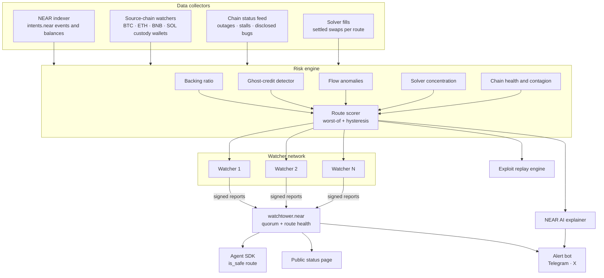

# 🛰️ Intents Watchtower

### The smoke alarm for NEAR Intents.
**Don't trust the bridge. Watch it.**

> An open, verifiable, real-time safety layer for NEAR Intents. It proves the money behind every balance is really there, catches exploits as they start, and gives every AI agent and app a single on-chain call to ask: *"Is this route safe right now?"*

**Track:** Open Innovation (secondary fit: AI Security & Defense, Agent Economy)
**Hackathon:** NEAR Hackathon · development ends **14 Nov 2026, 23:59 UTC** (00:59 on 15 Nov in Lagos)

---

## Table of contents

1. [The problem](#1-the-problem)
2. [The insight](#2-the-insight)
3. [What Watchtower is](#3-what-watchtower-is)
4. [10 things nobody else has](#4-10-things-nobody-else-has)
5. [How it compares](#5-how-it-compares)
6. [Architecture](#6-architecture)
7. [The risk engine, check by check](#7-the-risk-engine-check-by-check)
8. [Route status and scoring](#8-route-status-and-scoring)
9. [The watchtower.near contract](#9-the-watchtowernear-contract)
10. [Agent SDK](#10-agent-sdk)
11. [The watcher network](#11-the-watcher-network)
12. [AI incident explainer](#12-ai-incident-explainer)
13. [Exploit replay: the time machine](#13-exploit-replay-the-time-machine)
14. [Data model](#14-data-model)
15. [Tech stack and repo structure](#15-tech-stack-and-repo-structure)
16. [11-day build plan](#16-11-day-build-plan)
17. [Demo script](#17-demo-script)
18. [Submission kit](#18-submission-kit)
19. [Why this matters to NEAR](#19-why-this-matters-to-near)
20. [Roadmap and business model](#20-roadmap-and-business-model)
21. [Assumptions and open questions](#21-assumptions-and-open-questions)
22. [Sources](#22-sources)

---

## 1. The problem

NEAR Intents is NEAR's growth engine. It has processed over $30 billion across roughly 35 blockchains, and its revenue now funds NEAR token buybacks. But every chain it connects to is also a door that can be broken.

**What happened in 2026:**

| Date | Incident | Impact |
|---|---|---|
| April 2026 | A zero-day bug in Litecoin (a connected chain, not NEAR) | About $600K of exposure through NEAR Intents, covered by the team |
| 1 Oct 2026 | A bug in how the Omni deposit/withdrawal system interacted with the Intents contract let attackers withdraw funds that had nothing behind them | About $3.8M exploited, cross-chain swaps paused, NEAR token fell 6–7.5%. Funds were returned in full on 3 Oct |
| Oct 2026 | DFINITY's founder publicly questioned the security of NEAR's confidential (TEE-based) privacy layer and its unnamed operators | Reputational doubt about NEAR's privacy story |

**And the quieter risk:** if a handful of solvers supply most of the liquidity on a route, quotes reflect their appetite, not real competition. Thin routes behave worse than headline volume suggests.

**The common thread is trust.** Today, a user, a wallet, an institution or an AI agent has no independent way to answer three questions before moving money:

1. Is every credited token actually backed by real assets on its home chain right now?
2. Is anything abnormal happening on this route at this minute?
3. Is the liquidity on this route real and competitive, or one solver deep?

Existing NEAR Intents dashboards (Blockworks, Dune, Flipside, DefiLlama, NEAR's revenue page) measure **growth**: volume, swaps, fees, TVL. Nobody measures **safety**.

---

## 2. The insight

The October exploit had a signature: **credits on NEAR that had no matching deposit on the source chain.** That's a mismatch you can detect from public data, continuously, if someone is watching both sides at once.

And in an agent economy, a dashboard isn't enough. Agents don't read dashboards. **Safety has to be a contract call.**

---

## 3. What Watchtower is

Watchtower is three things in one:

1. **A proof-of-backing monitor** that reconciles what's held on each source chain against what's credited on NEAR, every few minutes, per asset, per chain.
2. **An on-chain circuit breaker** (`watchtower.near`) that any app, wallet or AI agent can query with one call, `is_safe(route)`, before executing a swap.
3. **An open watcher network** where anyone can run the open-source checker, sign reports and reach consensus, so the safety signal itself doesn't depend on trusting one operator.

Plus a public status page, an alert bot and plain-language incident explanations powered by NEAR AI.

---

## 4. 10 things nobody else has

| # | Feature | Why it's unique |
|---|---|---|
| 1 | **On-chain circuit breaker** (`is_safe(route)`) | Existing tools are dashboards for humans. This is a safety signal that software can act on, inside the same transaction flow. |
| 2 | **Proof of Backing per route** | Measures whether the money exists, not how much moved. No NEAR Intents tool shows backing ratios today. |
| 3 | **Ghost-credit detector** | Matches every credit on NEAR to a real source-chain deposit. Unmatched credits are the exact pattern of the October exploit. |
| 4 | **Contagion map** | When a connected chain has an outage or bug (like Litecoin in April), every route touching it is automatically downgraded. The risk follows the dependency graph. |
| 5 | **Solver concentration index** | Shows how dependent each route is on one or two solvers (HHI score + top-solver share). Liquidity honesty, not liquidity volume. |
| 6 | **Watchers watching the watcher** | Multiple independent watchers sign reports; the contract only updates on a quorum. It's a direct answer to the "unknown operators" criticism: the safety layer is permissionless and verifiable. |
| 7 | **Exploit time machine** | Replays historical blocks through the engine to show exactly when the alarm would have fired. Every claim is backtestable. |
| 8 | **Safety receipts** | Each swap can record the route's health status at execution time, a verifiable proof that the user or agent checked before moving money. |
| 9 | **Plain-language, multilingual alerts** | NEAR AI turns raw anomalies into one-sentence explanations in English, Pidgin, French, Spanish and more. Safety for everyone, not just engineers. |
| 10 | **Fail-closed by design** | If data goes stale, routes go to "unknown" and `is_safe` returns false by default. Silence is never mistaken for safety. |

---

## 5. How it compares

| | Analytics dashboards (Blockworks, Dune, Flipside, DefiLlama) | NEAR Intents SHIELD | Agent spend guards (common hackathon idea) | **Intents Watchtower** |
|---|---|---|---|---|
| What it watches | Volume, fees, TVL | Illicit flows from outside hacks | An agent's own spending limits | **Protocol solvency and route safety** |
| Who it's for | Analysts, investors | NEAR Intents team | One agent owner | **Every user, wallet, app and agent** |
| Machine-readable on-chain | No | Internal | Per agent | **Yes, `is_safe(route)`** |
| Independent and verifiable | Partly | No (internal) | N/A | **Yes, open-source + watcher quorum** |
| Detects backing gaps | No | No | No | **Yes** |
| Cross-chain contagion | No | No | No | **Yes** |
| Backtestable | No | No | No | **Yes, exploit replay** |

> Spend guards answer "is my agent spending too much?" Watchtower answers "is the road my money is about to take still standing?" They're complementary, not competing.

---

## 6. Architecture



**Flow in one sentence:** collectors pull data from both sides of every bridge → the engine runs five checks and scores each route → independent watchers sign the result → `watchtower.near` updates when a quorum agrees → apps, agents and people read it.

---

## 7. The risk engine, check by check

Every check produces a **severity** (green / amber / red / unknown) plus **reason codes** that explain why.

### Check 1: Backing ratio (proof of backing)

**Question:** For each asset, is what's credited on NEAR fully backed by what's held on its home chain?

```
BackingRatio(asset, chain) =
    (custody_balance_on_source_chain + in_flight_deposits)
    ÷ (total_credited_on_NEAR + pending_withdrawals)
```

- `custody_balance_on_source_chain`: sum of balances in the known deposit/custody addresses on that chain
- `total_credited_on_NEAR`: total supply of that asset's token inside `intents.near`
- In-flight and pending terms prevent false alarms while deposits confirm and withdrawals settle

| Backing ratio | Status |
|---|---|
| ≥ 100% | 🟢 Green |
| 99.5% – 100% (within confirmation tolerance) | 🟡 Amber |
| < 99.5%, or falling fast | 🔴 Red |
| Data older than freshness limit | ⚪ Unknown |

**Reason codes:** `BACKING_BELOW_THRESHOLD`, `BACKING_DROP_FAST`, `CUSTODY_DATA_STALE`

### Check 2: Ghost-credit detector

**Question:** Does every credit on NEAR have a real deposit behind it?

1. For every credit/mint event on `intents.near`, look for a matching deposit on the source chain (amount, asset, destination, timestamp window).
2. Allow a matching window based on that chain's confirmation time (for example, Bitcoin needs longer than BNB Chain).
3. A credit with no matching deposit after the window becomes a **ghost credit**.

| Condition | Status |
|---|---|
| All credits matched | 🟢 |
| Small unmatched value, still inside window | 🟡 |
| Any unmatched credit past the window, or unmatched credits followed by fast withdrawals | 🔴 |

This is the check designed around the October exploit pattern: value leaving with nothing behind it.

**Reason codes:** `GHOST_CREDIT`, `GHOST_CREDIT_WITHDRAWN`

### Check 3: Flow anomalies

**Question:** Is money moving in a way that looks like an attack?

- **Outflow velocity:** withdrawals per asset per hour compared to the 30-day baseline (rolling z-score). A z-score above 4 is amber, above 6 is red.
- **Hot wallet drain:** a custody hot wallet losing more than X% of its balance within Y minutes.
- **Fresh-account withdrawals:** large withdrawals from accounts created very recently.
- **Mint-then-exit:** a credit followed by a withdrawal to a different chain within minutes, at unusual size.

**Reason codes:** `OUTFLOW_SPIKE`, `HOT_WALLET_DRAIN`, `FRESH_ACCOUNT_EXIT`, `MINT_THEN_EXIT`

### Check 4: Solver concentration

**Question:** Is this route's liquidity real and competitive?

Using settled swaps per route over the last 24 hours:

```
HHI = Σ (solver_share_i × 100)²
```

The Herfindahl–Hirschman Index is the standard measure regulators use for market concentration (0 = perfectly spread, 10,000 = one solver does everything).

| Measure | Status |
|---|---|
| HHI < 1,500 and top solver < 40% | 🟢 Competitive |
| HHI 1,500 – 2,500 or top solver 40–70% | 🟡 Concentrated |
| HHI > 2,500 or top solver > 70% | 🔴 Single point of failure |

**Stretch:** "honest depth," the price impact at the size the user actually wants to trade, if a quote endpoint is accessible.

**Reason codes:** `SOLVER_CONCENTRATED`, `SINGLE_SOLVER_ROUTE`, `THIN_DEPTH`

### Check 5: Chain health and contagion

**Question:** Is any chain this route touches in trouble?

- Block production stalls (no new blocks for longer than normal)
- Finality delays or deep reorganizations
- Disclosed client bugs or security advisories
- Stablecoin depegs on the source chain

**Contagion rule:** a route inherits the worst status of every chain it touches. If Litecoin turns red, every route in or out of Litecoin turns red automatically, even if nothing has gone wrong on NEAR yet.

**Reason codes:** `CHAIN_STALLED`, `CHAIN_REORG`, `CHAIN_ADVISORY`, `ASSET_DEPEG`

---

## 8. Route status and scoring

A **route** is a path like `btc:bitcoin → usdc:near` or `eth:ethereum → sol:solana`.

**Status = worst of all components.** Safety systems should be pessimistic: one red check makes the route red.

**Score (0–100)** for nuance on the dashboard:

```
score = 100
      − backing_penalty     (0–40)
      − ghost_credit_penalty (0–40)
      − anomaly_penalty      (0–25)
      − concentration_penalty (0–15)
      − chain_health_penalty  (0–30)
(floored at 0)
```

**Anti-flapping rules:**
- Hysteresis: a route needs N consecutive clean checks to go from red back to amber, and amber back to green.
- Red is instant: escalation never waits.

**Freshness rule (fail-closed):** if any required input is older than its freshness limit, the route becomes ⚪ Unknown and `is_safe` returns `false` unless the caller opts in to accept unknowns.

---

## 9. The watchtower.near contract

> Interface sketch in Rust (near-sdk). Final types may differ.

```rust
#[derive(BorshSerialize, BorshDeserialize, Serialize, Deserialize, Clone, PartialEq)]
pub enum Status { Green, Amber, Red, Unknown }

pub struct RouteHealth {
    pub status: Status,
    pub score: u8,                 // 0–100
    pub reasons: Vec<String>,      // reason codes, e.g. "GHOST_CREDIT"
    pub updated_at_ns: u64,
    pub report_hash: String,       // hash of the full off-chain report
    pub signers: u8,               // watchers that agreed
}

// ---------- read methods (free view calls) ----------

/// True only if the route is Green (or Amber when allow_amber = true)
/// and the status is fresher than max_age_sec. Fail-closed by default.
pub fn is_safe(&self, route_id: String, max_age_sec: u64, allow_amber: bool) -> bool;

pub fn get_route_health(&self, route_id: String) -> Option<RouteHealth>;
pub fn list_routes(&self, from_index: u32, limit: u32) -> Vec<(String, RouteHealth)>;
pub fn get_watchers(&self) -> Vec<AccountId>;

// ---------- write methods ----------

/// Registered watchers submit signed reports.
/// Status updates only when `quorum` watchers agree on the same report_hash.
pub fn submit_report(&mut self, route_id: String, health: RouteHealth, signature: Vec<u8>);

/// Records a safety receipt: route status at the moment a swap executes.
pub fn record_receipt(&mut self, route_id: String, intent_hash: String) -> ReceiptId;

// ---------- admin (MVP; moves to DAO governance later) ----------
pub fn add_watcher(&mut self, account: AccountId);
pub fn set_quorum(&mut self, quorum: u8);
```

**Design choices:**
- Reads are free view calls, so any frontend or agent can check before every swap at no cost.
- The full report (raw numbers, evidence, transaction links) lives off-chain; only its hash goes on-chain, so anyone can verify the report matches what was signed.
- Red status can be posted by a single watcher (fast escalation); returning to green needs a quorum (slow recovery). Getting safer is hard, raising the alarm is easy.

---

## 10. Agent SDK

One line for any app or AI agent:

```ts
import { Watchtower } from "@intents-watchtower/sdk";

const wt = new Watchtower({ network: "mainnet" });

// Before any swap
const route = "btc:bitcoin->usdc:near";
if (!(await wt.isSafe(route, { maxAgeSec: 300 }))) {
  const health = await wt.getRouteHealth(route);
  console.log(`Skipping ${route}: ${health.reasons.join(", ")}`);
  return; // or pick an alternative route
}
await executeSwap(route, amount);
```

**Wrapper mode** for agent frameworks:

```ts
const safeAgent = withWatchtower(agent, { allowAmber: false });
// Every swap the agent attempts is checked automatically.
```

**Embeddable badge** for wallets and frontends:

```html
<watchtower-badge route="eth:ethereum->usdc:near"></watchtower-badge>
<!-- shows 🟢 Backed 100.2% · Updated 1 min ago -->
```

---

## 11. The watcher network

**Problem it solves:** a safety signal run by one company is just another thing to trust.

**How it works:**
1. The checker is open source and deterministic: same input blocks → same report → same hash.
2. Anyone can run a watcher node and register its account.
3. Each watcher computes the report independently and signs its hash.
4. `watchtower.near` updates a route when a quorum (for example, 2 of 3 in the MVP) signs the same hash.
5. Disagreement between watchers is itself a public signal, shown on the status page.

**Hackathon version:** 3 watchers run by you on different machines, quorum 2 of 3.
**Future version:** watchers stake NEAR, earn rewards for accurate early alerts and get slashed for provably false reports ("proof of vigilance").

---

## 12. AI incident explainer

Raw alert:
```
route=btc:bitcoin->usdc:near status=RED reasons=[GHOST_CREDIT, OUTFLOW_SPIKE]
unmatched_credit=4.21 BTC outflow_z=7.3
```

What people see, generated by NEAR AI:

> 🔴 **BTC route paused.** 4.21 BTC was credited on NEAR without a matching Bitcoin deposit, and withdrawals are running 7× above normal. Avoid this route until it turns green.

> 🔴 **(Pidgin)** BTC route don stop. Dem credit 4.21 BTC for NEAR but no Bitcoin enter, and people dey comot money pass normal. Abeg no use this route until e turn green.

Rules:
- The AI only explains; it never decides status. Status comes from deterministic checks, so the alarm can't be "hallucinated."
- Every explanation links to the raw evidence: transactions, balances, timestamps.

---

## 13. Exploit replay: the time machine

The single most powerful demo moment.

1. Load historical blocks from NEAR and the affected source chain around **1 October 2026**.
2. Run the engine block by block, as if it were live.
3. Show the timeline:

```
T−30 min  🟢 All routes healthy
T+00      First unmatched credit appears          → 🟡 GHOST_CREDIT (inside window)
T+??      Withdrawals spike, credit still unmatched → 🔴 GHOST_CREDIT_WITHDRAWN + OUTFLOW_SPIKE
T+??      is_safe() returns false for affected routes
...       Public disclosure / service pause
```

4. The headline number: **how many minutes earlier Watchtower would have turned red, and how much value moved after that point.**

> ⚠️ Only publish real numbers after running the replay. If the historical data needed isn't accessible, replay the April Litecoin incident or simulate a ghost-credit attack on testnet instead, and label it clearly as a simulation.

---

## 14. Data model

| Table | Key fields |
|---|---|
| `credits` | asset, amount, account, near_tx, block, timestamp, matched_deposit_id |
| `deposits` | asset, chain, amount, source_tx, destination, confirmations, timestamp |
| `withdrawals` | asset, chain, amount, near_tx, dest_tx, account, timestamp |
| `custody_snapshots` | chain, address, asset, balance, block, timestamp |
| `solver_fills` | route, solver, amount_in, amount_out, timestamp |
| `chain_status` | chain, last_block_time, finality_lag, advisory, timestamp |
| `route_health` | route, status, score, reasons[], report_hash, computed_at |
| `alerts` | route, severity, reasons[], explanation, evidence_links[], sent_at |
| `receipts` | intent_hash, route, status_at_execution, receipt_id |

---

## 15. Tech stack and repo structure

| Layer | Choice |
|---|---|
| Contract | Rust + near-sdk (or near-sdk-js if faster for you) |
| Indexer and watchers | TypeScript (Node.js), NEAR RPC / indexer, chain RPCs |
| Database | Postgres (Supabase for speed) |
| Risk engine | TypeScript workers on a 1–5 minute schedule |
| Status page | Next.js + Tailwind, charts with Recharts |
| Alerts | Telegram Bot API, X posts |
| AI explainer | NEAR AI inference |
| SDK | TypeScript package (`@intents-watchtower/sdk`) |

```
intents-watchtower/
├── contracts/watchtower/        # Rust contract: route health, quorum, receipts
├── collectors/
│   ├── near-indexer/            # intents.near credits, withdrawals, supply
│   ├── source-chains/           # BTC, ETH, BNB custody watchers
│   ├── chain-status/            # stalls, reorgs, advisories
│   └── solver-fills/            # settled swaps per route
├── engine/
│   ├── checks/                  # backing, ghost-credit, anomalies, concentration, chain-health
│   ├── scorer.ts                # worst-of + hysteresis + freshness
│   └── replay/                  # historical block replay
├── watcher/                     # signs report hashes, submits to contract
├── explainer/                   # NEAR AI prompts + multilingual output
├── sdk/                         # isSafe, getRouteHealth, withWatchtower, badge
├── app/                         # public status page (Next.js)
├── bot/                         # Telegram + X alerts
└── docs/                        # this file, architecture, methodology
```

---

## 16. 11-day build plan

Today is **Wed 4 Nov**. Deadline is **Sat 14 Nov, 23:59 UTC**.

| Day | Date | Goal | Done when |
|---|---|---|---|
| 0 | Wed 4 Nov | **Research data access** | You know where custody addresses, credit events and solver fills come from for 3 assets |
| 1 | Thu 5 Nov | Repo, database, NEAR indexer | Credits and withdrawals for 3 assets flowing into Postgres |
| 2 | Fri 6 Nov | Source-chain watchers | Custody balances for BTC, ETH, BNB snapshotting every few minutes |
| 3 | Sat 7 Nov | Backing ratio + ghost-credit checks | Both checks producing statuses with reason codes |
| 4 | Sun 8 Nov | Anomalies, concentration, chain health | All 5 checks running; scorer combines them |
| 5 | Mon 9 Nov | `watchtower.near` contract | Deployed on testnet: `submit_report`, `is_safe`, `get_route_health` |
| 6 | Tue 10 Nov | Watchers + quorum | 3 watchers signing; contract updating on 2-of-3 |
| 7 | Wed 11 Nov | Status page + SDK | Live page with route cards; `isSafe()` works from a demo agent |
| 8 | Thu 12 Nov | Alerts + AI explainer + replay | Telegram alerts in English and Pidgin; replay running on real or simulated incident |
| 9 | Fri 13 Nov | Polish + mainnet read-only + record demo | Demo video recorded; README finished |
| 10 | Sat 14 Nov | **Ship** | Repo public, X demo post live, form submitted **before 23:59 UTC** |

**Cut order if behind schedule** (drop from the top first):
1. Multilingual alerts (keep English)
2. Safety receipts
3. Embeddable badge
4. Solver "honest depth"
5. Watcher quorum (fall back to single signer, describe quorum in docs)

**Never cut:** backing ratio, ghost-credit detector, `is_safe` contract call, status page, replay or simulation.

---

## 17. Demo script

**Length:** 2–3 minutes.

1. **(0:00) The hook.** Show the October headlines. "NEAR Intents moved over $30 billion. On 1 October, $3.8 million walked out with nothing behind it. Nobody outside saw it coming."
2. **(0:20) The page.** Open the status page: every route green, backing ratios at 100%+, solver concentration per route.
3. **(0:50) The time machine.** Run the replay. Watch routes flip from green to amber to red. Show the minute Watchtower would have caught it.
4. **(1:30) The agent.** Show a demo AI agent trying to swap on a red route. It calls `is_safe()`, gets `false`, and routes around it automatically.
5. **(1:55) The alert.** Show the Telegram alert arriving in English and Pidgin, with evidence links.
6. **(2:15) The trust layer.** Show 3 watchers signing the same report hash and the contract updating on quorum. "Don't trust us either. Run a watcher."
7. **(2:35) The close.** "Intents Watchtower: the smoke alarm for NEAR Intents. Open source, on-chain, and live."

---

## 18. Submission kit

### One-liner
Intents Watchtower is an open, verifiable safety layer for NEAR Intents: it proves cross-chain balances are backed, detects exploits as they start, and gives every app and AI agent an on-chain `is_safe(route)` check.

### "What did you build?" (form answer, under 2,000 characters)

> NEAR Intents moves billions across ~35 chains, but no one outside the team can verify in real time that credited balances are backed or that a route is safe. The October 2026 exploit ($3.8M withdrawn with nothing behind it) and the April Litecoin incident showed the risk lives at the bridges.
>
> Intents Watchtower watches both sides of every bridge. It reconciles custody balances on source chains against credits on NEAR (proof of backing), flags credits with no matching deposit (the October exploit pattern), detects abnormal outflows, measures solver concentration per route, and propagates connected-chain outages to every affected route.
>
> Results are signed by independent watchers and written to watchtower.near once a quorum agrees. Any wallet, app or AI agent can call is_safe(route) before swapping, a circuit breaker for the agent economy. Stale data fails closed. NEAR AI turns alerts into plain-language explanations in multiple languages, and a replay engine backtests the engine against real incidents.
>
> NEAR fit: built on NEAR Intents data, a NEAR smart contract as the on-chain safety oracle, NEAR AI for explanations, and an SDK for NEAR agents. It turns "trust us" into "verify it yourself," which is what institutions and agents need before moving serious value through NEAR.

### X demo post

> Built at #NEARHackathon: Intents Watchtower 🛰️
>
> The smoke alarm for @NEARProtocol Intents.
> ✅ Proof of backing across chains
> 👻 Catches credits with nothing behind them
> 🤖 is_safe(route) for every AI agent
> 🔁 Replays real incidents to prove it works
>
> Don't trust. Watch. 👇
> [demo video] [repo link]

### Submission checklist
- [ ] All code written after the hackathon announcement
- [ ] Public GitHub repository with README and this spec
- [ ] Demo post on X tagging @NEARProtocol with #NEARHackathon and the video
- [ ] Form submitted with repo link, X post link and your `.near` wallet
- [ ] Tracks selected: Open Innovation (+ AI Security & Defense, Agent Economy if allowed)

---

## 19. Why this matters to NEAR

- **It protects NEAR's main revenue engine.** Intents revenue funds NEAR buybacks; every exploit hits the token directly.
- **It unlocks institutional money.** Funds and market makers need independent, verifiable safety signals before routing size.
- **It makes the agent economy safe to automate.** Agents can't call support or read the news. They need a machine-readable "stop" sign.
- **It answers the critics with code.** Instead of arguing about trust, NEAR can point to an open watcher network anyone can run.
- **It turns incidents into proof of resilience.** When something breaks, the public sees it was caught, contained and explained.

---

## 20. Roadmap and business model

**After the hackathon:**
1. Cover every NEAR Intents asset and chain
2. Confidential Intents coverage: publish attestation status and checks for the private shard operators
3. Permissionless watchers with staking, rewards and slashing
4. DAO governance of thresholds and watcher set
5. Native integration in wallets and near.com-style frontends (badge + pre-swap check)
6. Risk feeds for on-chain insurance: route scores used to price cover

**Revenue options:**
- Free public page and `is_safe` reads (public good)
- Paid API with historical data, webhooks and custom thresholds for funds, exchanges and market makers
- Ecosystem grants from NEAR Foundation for public-good security infrastructure
- Risk data licensing for insurers and auditors

---

## 21. Assumptions and open questions

Be honest with judges about these. It builds credibility.

| Question | Why it matters | Fallback |
|---|---|---|
| Which custody/deposit addresses does NEAR Intents use on each chain? | Backing ratio needs them | Start with chains where addresses are documented or traceable on-chain |
| Is solver identity visible in settled swaps? | Needed for concentration index | Use settling accounts as solver proxies |
| Is historical data for 1 Oct accessible? | Needed for the real replay | Replay a simulated ghost-credit attack on testnet, clearly labeled |
| How are in-flight deposits and withdrawals tracked? | Prevents false alarms | Wider tolerance band in MVP |
| Can watcher quorum be done in time? | Core trust feature | Single signer for MVP, quorum shown in architecture |

**Claims to avoid until tested:** "would have caught the October exploit," exact minutes saved, exact detection rates.

---

## 22. Sources

- [TradingView / U.Today: Near Intents confirms $3.8M exploit](https://www.tradingview.com/news/u_today:812a5672f094b:0-near-intents-breaks-silence-on-3-8-million-exploit-near-token-slumps-7-5/)
- [CryptoRank: NEAR Intents pauses cross-chain services after exploit](https://cryptorank.io/news/feed/f217d-near-intents-pauses-cross-chain-services-after-exploit)
- [CoinGecko: Near Intents (funds returned 3 Oct)](https://www.coingecko.com/en/exchanges/near-intents)
- [Levex: NEAR Intents risks, Litecoin incident and solver concentration](https://levex.com/en/blog/near-intents)
- [KuCoin: DFINITY founder's criticism of NEAR's privacy layer](https://www.kucoin.com/news/flash/near-surges-5-amid-ecosystem-growth-despite-dfinity-founder-s-criticism)
- [DefiLlama: NEAR Intents TVL, revenue and buybacks](https://defillama.com/protocol/near-intents)
- [Blockworks: NEAR Intents dashboard](https://app.blockworks.com/projects/near-protocol/analytics/near-intents-dashboard)
- [NEAR: Research & Analytics hub](https://www.near.org/research-analytics)
- [NEAR Intents docs: Solver quickstart](https://docs.near-intents.org/integration/market-makers/quickstart)

---

*Intents Watchtower. Don't trust. Watch.* 🛰️
